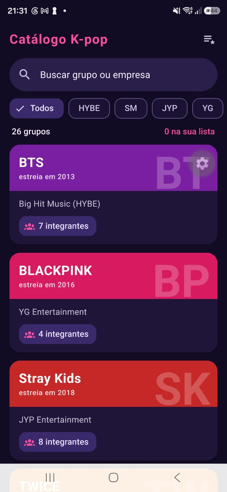

# Catálogo de Grupos de K-pop

Aplicativo desenvolvido com Expo, React Native e React Native Paper para consultar grupos de K-pop e organizar preferências. É possível pesquisar grupos, visualizar informações sobre eles e classificá-los de acordo com o interesse do usuário.

## 1. Pesquisa sobre a biblioteca

### 1.1 Nome, documentação, repositório e licença

A biblioteca escolhida foi a **React Native Paper**, uma biblioteca de componentes de interface para aplicativos desenvolvidos com React Native. Ela segue as diretrizes do Material Design e oferece componentes prontos que podem ser personalizados.

- **Documentação oficial:** https://callstack.github.io/react-native-paper/
- **Repositório:** https://github.com/callstack/react-native-paper
- **Licença:** MIT, que permite utilizar e modificar o código conforme as condições dessa licença.

### 1.2 Responsáveis e última versão publicada

A React Native Paper é mantida pela empresa Callstack, com a participação de colaboradores da comunidade de desenvolvimento.

Na consulta realizada em 12/10/2026, a versão estável mais recente identificada foi a **5.15.3**, publicada em **26 de maio de 2026**. O projeto também apresenta uma versão 6.0.0-alpha.0, que é uma versão de testes e não deve ser confundida com a versão estável.

Fontes:
- [Repositório e histórico de versões](https://github.com/callstack/react-native-paper/releases)
- [Pacote no npm](https://www.npmjs.com/package/react-native-paper)

### 1.3 Popularidade da biblioteca

A React Native Paper possui uma comunidade ativa e é utilizada em diversos projetos. Na consulta feita em 12/10/2026, o repositório apresentava aproximadamente **14,5 mil estrelas no GitHub**. A página do pacote no npm indicava cerca de **398 mil downloads semanais**.

Esses números podem mudar com o tempo, mas ajudam a mostrar que a biblioteca é conhecida no desenvolvimento de interfaces com React Native.

Fontes:
- [Estrelas e informações do repositório no GitHub](https://github.com/callstack/react-native-paper)
- [Downloads e versões no npm](https://www.npmjs.com/package/react-native-paper)

### 1.4 Plataformas e compatibilidade com Expo

A biblioteca oferece suporte a aplicativos Android e iOS. Também pode ser utilizada em projetos com suporte à web, dependendo da configuração do React Native e do Expo.

No projeto deste trabalho, foi utilizado o Expo Go para executar o aplicativo durante os testes. Para os componentes utilizados, não foi necessário criar um development build.

Documentação: https://callstack.github.io/react-native-paper/docs/guides/getting-started

### 1.5 Instalação e configuração

Em um projeto Expo, a instalação pode ser feita com:

```bash
npx expo install react-native-paper react-native-safe-area-context
```

Depois, é necessário configurar o `PaperProvider`, responsável por disponibilizar os componentes e o tema da biblioteca para o restante do aplicativo.

Um exemplo básico é:

```jsx
import { PaperProvider } from 'react-native-paper';

export default function App() {
  return (
    <PaperProvider>
      {/* Conteúdo do aplicativo */}
    </PaperProvider>
  );
}
```

Neste projeto, o tema foi personalizado a partir do `MD3LightTheme`, permitindo definir cores e manter uma aparência consistente entre as telas. Essa configuração está relacionada aos arquivos `App.js` e `src/theme/tema.js`.

Documentação: https://callstack.github.io/react-native-paper/docs/guides/theming

### 1.6 Principais componentes

A biblioteca oferece vários componentes que facilitam a construção de interfaces. Alguns dos utilizados neste projeto são:

| Componente | Função |
|---|---|
| `Appbar` | Organiza o cabeçalho das telas e suas ações. |
| `Searchbar` | Permite pesquisar grupos pelo campo de busca. |
| `Card` | Agrupa informações de cada grupo em um cartão. |
| `Chip` | Exibe informações curtas e opções de classificação. |
| `Badge` | Mostra pequenos indicadores na interface. |
| `Avatar.Text` | Apresenta iniciais ou letras em formato de avatar. |
| `List.Item` | Organiza informações em linhas de uma lista. |
| `Divider` | Separa visualmente os itens. |
| `Button` | Permite executar ações, como navegar para outra tela. |
| `Snackbar` | Exibe mensagens temporárias após determinadas ações. |

A documentação oficial apresenta os componentes e seus exemplos de uso: https://callstack.github.io/react-native-paper/docs/components/

### 1.7 Personalização

Uma das vantagens da React Native Paper é a possibilidade de adaptar a aparência dos componentes sem precisar construir cada elemento do zero.

O tema pode ser personalizado com cores próprias, enquanto propriedades e estilos permitem ajustar tamanhos, espaçamentos e outros detalhes. No catálogo, essa possibilidade foi utilizada para manter uma identidade visual relacionada ao tema do aplicativo e destacar as informações dos grupos.

### 1.8 Pontos positivos e negativos observados

Durante o desenvolvimento, percebi algumas vantagens da biblioteca:

- Os componentes prontos agilizam a montagem das telas.
- A interface mantém um padrão visual entre os diferentes elementos.
- É possível personalizar cores e estilos sem precisar criar todos os componentes do início.
- A documentação apresenta exemplos que ajudam a entender como utilizar cada recurso.

Por outro lado, alguns pontos exigem atenção. Para modificar determinados detalhes da aparência, é necessário conhecer as propriedades dos componentes e os estilos do React Native. Além disso, a biblioteca oferece uma identidade visual própria, então é preciso personalizar os elementos para que o aplicativo não fique com a aparência padrão de um projeto genérico.

### 1.9 Comparação com outra biblioteca

Uma alternativa é a **React Native Elements**, atualmente conhecida como React Native Elements/ RNEUI em sua documentação e repositório. Ela também oferece componentes reutilizáveis para interfaces com React Native.

| Critério | React Native Paper | React Native Elements |
|---|---|---|
| Proposta visual | Segue o Material Design. | Oferece componentes com uma abordagem mais flexível de interface. |
| Componentes prontos | Possui uma variedade de elementos para formulários, listas, cartões e navegação visual. | Também disponibiliza componentes para diferentes necessidades de interface. |
| Personalização | Utiliza temas e propriedades dos componentes. | Permite personalizar componentes e estilos. |
| Escolha para este projeto | Foi a biblioteca utilizada no aplicativo e permitiu desenvolver as telas com os componentes necessários. | Seria uma alternativa possível, mas exigiria adaptar a implementação do projeto. |

Referências:
- [React Native Paper](https://github.com/callstack/react-native-paper)
- [React Native Elements](https://github.com/react-native-elements/react-native-elements)

Escolhi a React Native Paper porque seus componentes atendiam às necessidades do catálogo e permitiam organizar as informações dos grupos de forma consistente.

## 2. Projeto desenvolvido

### 2.1 Sobre o aplicativo

O Catálogo de Grupos de K-pop permite consultar informações sobre grupos e registrar preferências pessoais. O aplicativo foi desenvolvido com Expo e React Native, utilizando a React Native Paper para os componentes de interface.

O projeto possui três telas principais:

- **Explorar:** apresenta os grupos cadastrados e permite pesquisar e filtrar os resultados.
- **Detalhes:** exibe informações de um grupo e permite alterar sua classificação.
- **Minha lista:** reúne os grupos organizados de acordo com as preferências registradas.

As classificações disponíveis são Favorito, Gostei, Pretendo ver e Não gostei.

### 2.2 Como executar o projeto

É necessário ter o Node.js instalado. Com o projeto baixado e aberto no terminal, execute:

```bash
npm install
npx expo start
```

O primeiro comando instala as dependências do projeto. O segundo inicia o servidor do Expo.

Para testar em um celular Android ou iOS, abra o Expo Go e leia o QR Code exibido no terminal, desde que o dispositivo e o computador estejam conectados à rede necessária para a conexão.

### 2.3 Componentes utilizados

Os principais componentes da React Native Paper utilizados no aplicativo e seus respectivos arquivos estão listados abaixo.

| Componente | Arquivo(s) |
|---|---|
| `PaperProvider` | `App.js` |
| `Appbar` | `src/screens/ExplorarScreen.js`, `src/screens/DetalhesScreen.js`, `src/screens/MinhaListaScreen.js` |
| `Searchbar` | `src/screens/ExplorarScreen.js` |
| `Card` | `src/components/GrupoCard.js`, `src/screens/DetalhesScreen.js` |
| `Chip` | `src/components/GrupoCard.js`, `src/components/StatusChip.js` e telas que utilizam a classificação |
| `Badge` | `src/screens/ExplorarScreen.js` |
| `Avatar.Text` | Telas de detalhes e lista, conforme a implementação |
| `List.Item` e `List.Icon` | `src/screens/DetalhesScreen.js`, `src/screens/MinhaListaScreen.js` |
| `Divider` | `src/screens/MinhaListaScreen.js` |
| `Button` | `src/screens/DetalhesScreen.js` |
| `Snackbar` | `src/screens/DetalhesScreen.js` |

Além desses componentes, o projeto utiliza recursos do React Native, como `FlatList`, `ScrollView`, `View` e `StyleSheet`, para organizar e exibir os elementos na tela.

### 2.4 Estado e interação

O aplicativo utiliza `useState` para controlar informações que mudam durante o uso, como o texto da pesquisa, os filtros selecionados e a classificação de cada grupo.

O contexto de lista, localizado em `src/context/ListaContext.js`, ajuda a compartilhar as classificações entre as telas. Dessa forma, quando o usuário altera a classificação de um grupo, essa informação pode ser consultada na tela Minha lista.

Os grupos são apresentados em listas utilizando `FlatList`, e os componentes visuais da React Native Paper são utilizados para exibir os dados e as opções disponíveis.

### 2.5 Organização dos arquivos

A estrutura principal do projeto está organizada da seguinte forma:

```text
kpop-grupos/
├── App.js
├── app.json
├── index.js
├── package.json
├── package-lock.json
├── README.md
├── assets/
└── src/
    ├── components/
    │   ├── GrupoCard.js
    │   └── StatusChip.js
    ├── constants/
    │   └── status.js
    ├── context/
    │   └── ListaContext.js
    ├── data/
    │   └── grupos.js
    ├── screens/
    │   ├── DetalhesScreen.js
    │   ├── ExplorarScreen.js
    │   └── MinhaListaScreen.js
    └── theme/
        └── tema.js
```

Os componentes reutilizáveis ficam na pasta `components`, as telas ficam em `screens`, os dados dos grupos ficam em `data`, as informações de classificação ficam em `constants`, o contexto compartilhado fica em `context` e a configuração visual fica em `theme`.

### 2.6 Capturas de tela

As imagens abaixo devem mostrar as três telas do aplicativo em funcionamento.

#### Tela Explorar



#### Tela Detalhes


#### Tela Minha lista


### 2.7 Considerações finais

O desenvolvimento deste projeto permitiu aplicar a React Native Paper em um aplicativo com diferentes telas, navegação, pesquisa e alteração de estado. A biblioteca facilitou a construção dos componentes visuais, enquanto a organização dos arquivos ajudou a separar as responsabilidades de cada parte do aplicativo.

## Fontes consultadas

- [Documentação oficial da React Native Paper](https://callstack.github.io/react-native-paper/)
- [Repositório oficial no GitHub](https://github.com/callstack/react-native-paper)
- [Histórico de versões](https://github.com/callstack/react-native-paper/releases)
- [Pacote no npm](https://www.npmjs.com/package/react-native-paper)
- [Guia de instalação e configuração](https://callstack.github.io/react-native-paper/docs/guides/getting-started)
- [Guia de personalização de temas](https://callstack.github.io/react-native-paper/docs/guides/theming)
- [Documentação do React Native Elements](https://github.com/react-native-elements/react-native-elements)

*Consulta às fontes: 12/10/2026.*